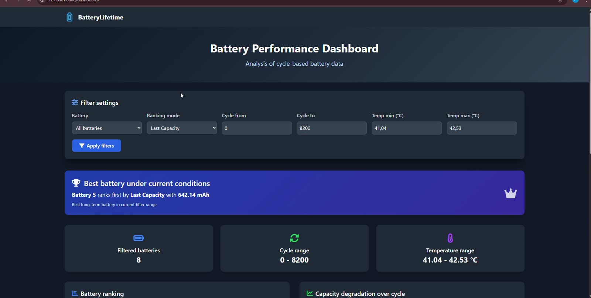
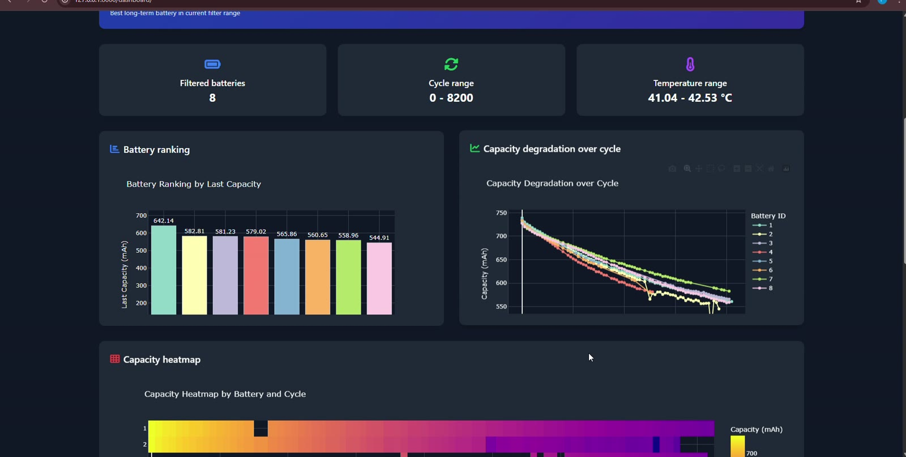
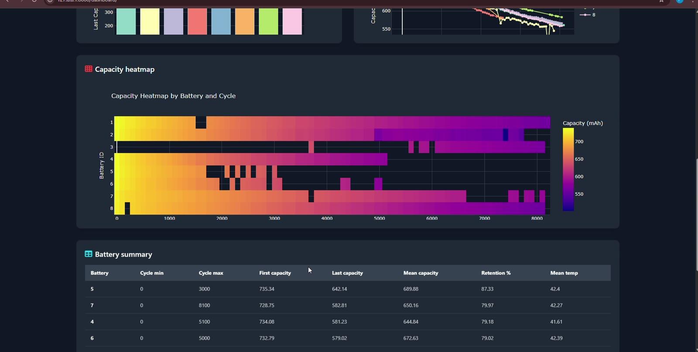
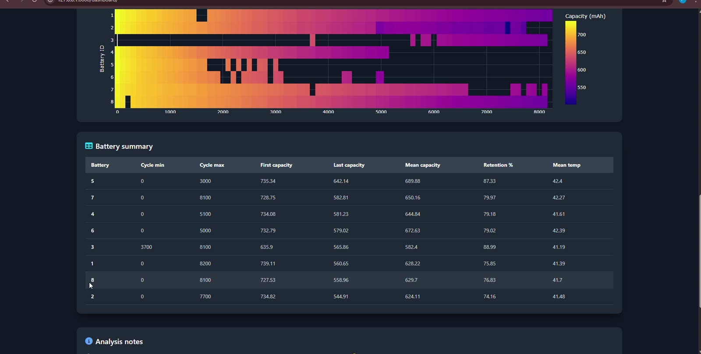

<div align="center">

# BatteryLifetime

### Interactive Battery Performance & Degradation Dashboard

Explore, compare, and visualize battery aging across charge/discharge cycles using an interactive web dashboard built with **Django**, **Pandas**, and **Plotly**.


</div>

## Dashboard preview

The following screenshots are **real frames captured from the project demonstration video**.



<table>
<tr>
<td width="50%"></td>
<td width="50%"></td>
</tr>
<tr>
<td align="center"><b>Battery ranking & degradation</b></td>
<td align="center"><b>Capacity heatmap</b></td>
</tr>
</table>



## Features

- **Battery comparison** — compare cells using their latest capacity, mean capacity, or capacity retention.
- **Interactive filters** — select batteries and adjust cycle and temperature ranges.
- **Capacity degradation chart** — examine how capacity changes over battery cycles.
- **Battery ranking** — identify the highest-ranked battery under the current filter settings.
- **Capacity heatmap** — inspect capacity measurements across batteries and cycles.
- **Summary table** — review per-battery capacity, temperature, cycle, and retention statistics.
- **Machine-learning training pipeline** — train a Random Forest regressor to estimate battery capacity from cycle-level features, including temperature and incremental-capacity-analysis (ICA) measurements.

> **Note:** The ML training command is included in the project, but the current dashboard focuses on **data exploration and comparison**. Model predictions are not displayed as a dashboard feature.

## Tech stack

| Layer | Technologies |
|---|---|
| Backend | Python, Django |
| Analysis | Pandas, NumPy |
| Visualization | Plotly |
| Machine learning | scikit-learn (Random Forest), joblib |
| Database | SQLite (local development) |
| UI | Django templates, HTML, CSS |

## Getting started

**Prerequisites:** Python 3.10+ and pip. Commands below assume you start in the **repository root**.

### 1. Clone and create a virtual environment

```bash
git clone https://github.com/YOUR_USERNAME/BatteryLifetime.git
cd BatteryLifetime
python -m venv .venv
```

Activate the environment:

**Windows (PowerShell):**

```powershell
.venv\Scripts\Activate.ps1
```

**Windows (Command Prompt):**

```bat
.venv\Scripts\activate.bat
```

**macOS / Linux:**

```bash
source .venv/bin/activate
```

### 2. Install dependencies

```bash
pip install -r requirements.txt
```

### 3. Set up the database and import sample data

```bash
cd battery_lifetime
python manage.py migrate
python manage.py import_and_generate_data --clear-old
```

The repository includes CSV source files in `battery/management/data/`. The importer reads `master_table.csv` when available and otherwise combines the cycle and ICA datasets.

### 4. Run the application

```bash
python manage.py runserver
```

Open **http://127.0.0.1:8000/** in your browser and visit **http://127.0.0.1:8000/dashboard/** to open the dashboard directly.

### 5. Optional: train the ML model

From the `battery_lifetime/` folder:

```bash
python manage.py train_model
```

The command trains a Random Forest regressor using a **battery-grouped train/test split** and prints **MSE, MAE, and R²**. It saves a generated `.joblib` file under `battery/ml/artifacts/`.

> Trained model files and the local SQLite database are deliberately excluded from the GitHub-ready download. They are created locally as needed.

## Project structure

```text
BatteryLifetime/
├── README.md
├── requirements.txt
├── .gitignore
├── docs/
│   └── screenshots/
│       ├── dashboard-overview.jpg
│       ├── battery-ranking-and-degradation.jpg
│       ├── capacity-heatmap.jpg
│       └── battery-summary.jpg
└── battery_lifetime/
    ├── manage.py
    ├── battery_lifetime/          # Django settings & URL configuration
    └── battery/
        ├── views.py              # Dashboard analysis and Plotly charts
        ├── models.py             # Battery measurement model
        ├── templates/battery/     # Home and dashboard pages
        ├── management/
        │   ├── commands/
        │   │   ├── import_and_generate_data.py
        │   │   └── train_model.py
        │   └── data/             # Included sample CSV datasets
        └── ml/train.py           # Random Forest training pipeline
```

## Data & methodology

The application analyzes cycle-level battery measurements such as **capacity (mAh)**, **cycle index**, **temperature**, and derived **ICA features**. The dashboard ranks cells based on a user-selected metric and plots capacity changes over time.

For the optional ML workflow, the model uses a median imputer and a Random Forest regressor. The train/test split is performed by **battery ID**, which helps avoid evaluating on rows from the same battery used in training.

**Important:** This is an exploratory/development project. Dashboard rankings and model metrics should not be interpreted as validated real-world battery-health guarantees.

## Development & deployment notes

- Django's default configuration is intended for **local development** (`DEBUG=True`). Do not deploy it unchanged.
- Set the `DJANGO_SECRET_KEY` environment variable to a strong, private value before production use; never commit secrets to Git.
- Configure production `ALLOWED_HOSTS`, `DEBUG=False`, and appropriate static file hosting before deploying.
- The repository includes sample CSVs but excludes virtual environments, generated model binaries, and local database files.

## License

No license has been selected yet. Add a `LICENSE` file if you want to specify reuse and distribution terms.
